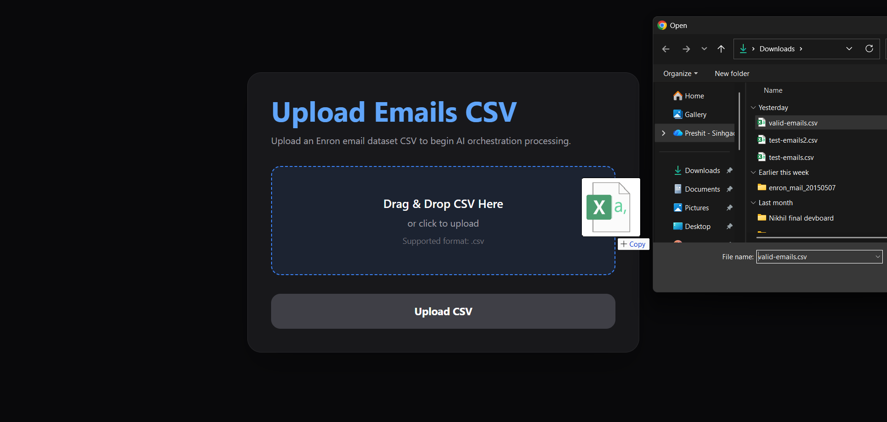
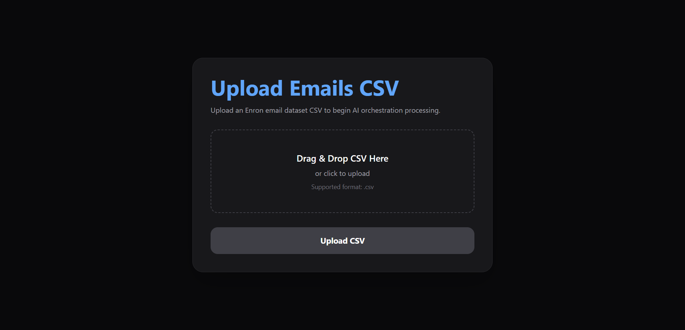
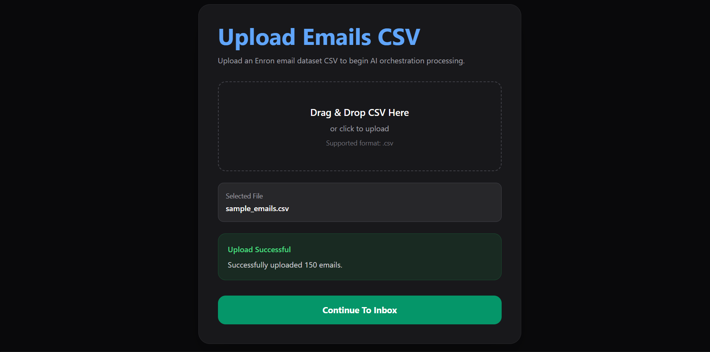
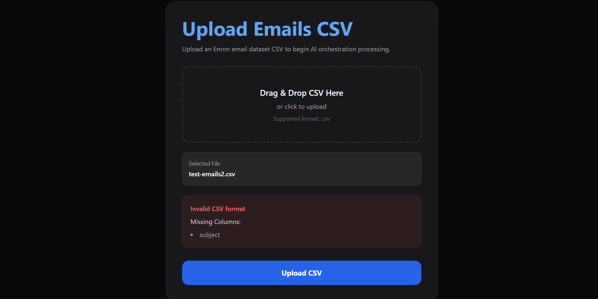
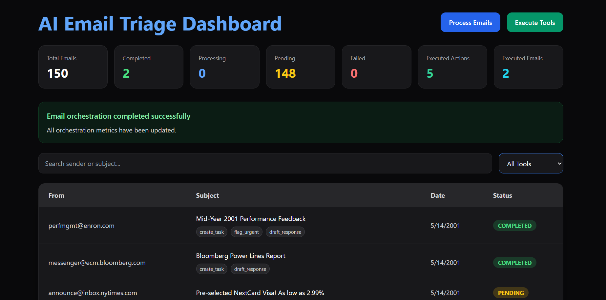
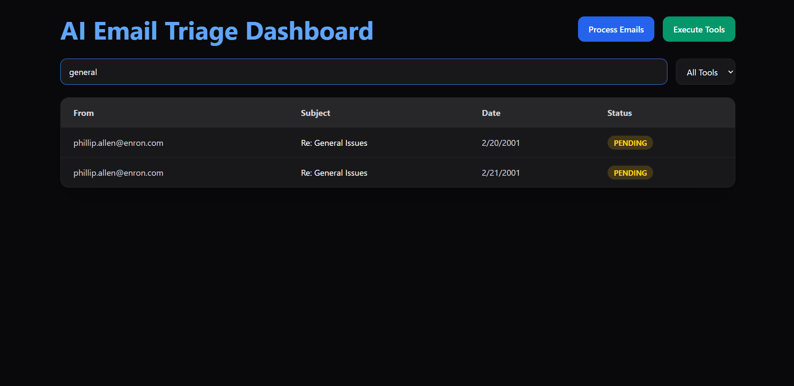
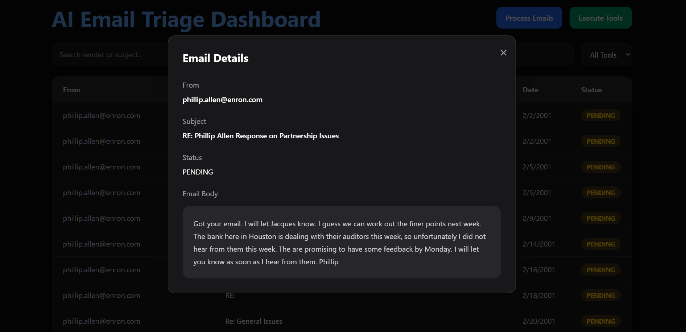
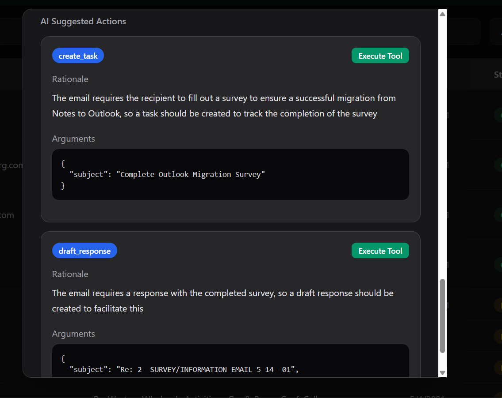
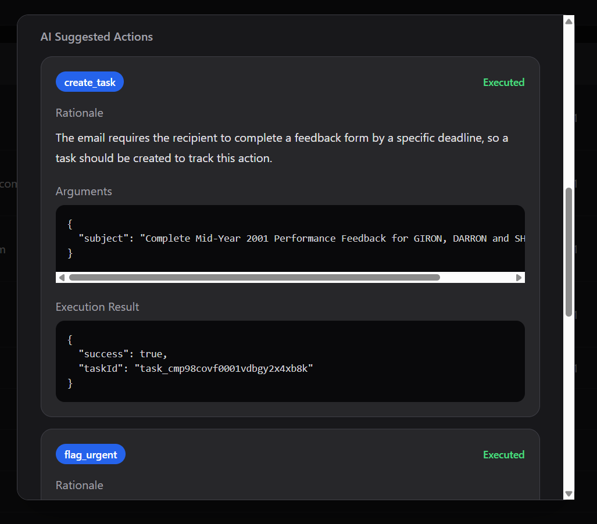
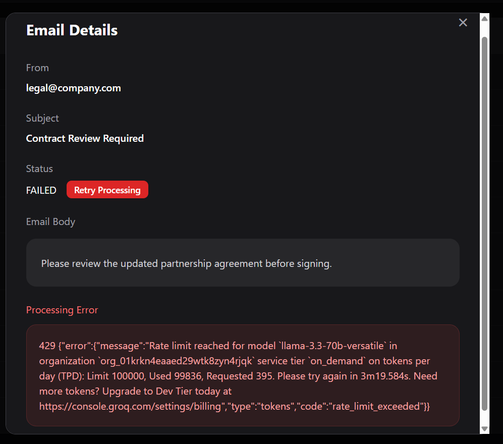

# AI Email Triage Assistant

## Overview

AI Email Triage Assistant is a full-stack AI orchestration platform that reads email datasets from CSV files, runs each message through an LLM-powered classification pipeline, produces actionable tool recommendations, and carries out mocked business actions on approval.

The project showcases:

- AI-driven email triage
- Multi-tool orchestration
- Structured, schema-validated tool-call generation
- Deterministic mocked execution
- Human-in-the-loop approval workflows
- CSV ingestion and validation
- Retryable orchestration pipelines
- Search and filtering capabilities
- Pagination, orchestration monitoring, and operational metrics
- A full-stack TypeScript architecture

It's built to mirror how modern AI agent systems coordinate decisions and operational workflows inside an enterprise email system.

---

## Contents

- [Overview](#overview)
- [Tech Stack](#tech-stack)
- [Features](#features)
  - [CSV Email Upload](#csv-email-upload) · [AI Email Classification](#ai-email-classification) · [AI Prompting Strategy](#ai-prompting-strategy) · [Multi-Tool Orchestration](#multi-tool-orchestration) · [Human-in-the-Loop Execution](#human-in-the-loop-execution) · [Deterministic Mocked Tool Execution](#deterministic-mocked-tool-execution) · [Search and Filtering](#search-and-filtering) · [Orchestration Monitoring](#orchestration-monitoring) · [Batch Email Processing](#batch-email-processing) · [Retry Failed Processing](#retry-failed-processing)
- [Architecture](#architecture)
- [Database Schema](#database-schema)
- [Project Structure](#project-structure)
- [API Endpoints](#api-endpoints)
  - [Emails](#emails) · [Tool Calls](#tool-calls) · [Upload](#upload)
- [Setup Instructions](#setup-instructions)
- [Environment Variables](#environment-variables)
- [Database Setup](#database-setup)
- [Tests](#tests)
- [Run Backend](#run-backend) · [Run Frontend](#run-frontend)
- [Hosting / Deployment](#hosting--deployment)
- [Example Workflow](#example-workflow)
- [Assumptions and Design Decisions](#assumptions-and-design-decisions)
- [Rate Limit Handling](#rate-limit-handling)
- [Troubleshooting](#troubleshooting)
- [Future Improvements](#future-improvements)
- [Screenshots](#screenshots)
- [Conclusion](#conclusion)

---

# Tech Stack

## Frontend

| Technology | Role in the project |
|---|---|
| **React 18** | Component-driven UI for the inbox, upload, and email-detail views |
| **TypeScript** | Static typing shared across components, API calls, and data models |
| **Vite** | Dev server and build tooling with fast HMR |
| **Tailwind CSS** | Utility-first styling for the dashboard and forms |
| **React Router** | Client-side routing between `/upload`, `/inbox`, and detail views |
| **Fetch API** | Communication with the backend REST endpoints |

## Backend

| Technology | Role in the project |
|---|---|
| **Node.js** | JavaScript runtime powering the API server |
| **Express.js** | REST API framework — routes, controllers, middleware |
| **TypeScript** | End-to-end type safety on the server |
| **Prisma ORM** | Schema definition, migrations, and typed database access |
| **SQLite** | Default embedded database (Postgres-ready via Prisma) |
| **Multer** | Handles multipart CSV file uploads |
| **csv-parser** | Streams and parses uploaded CSV rows into email records |

## AI / LLM

| Technology | Role in the project |
|---|---|
| **Groq API** | Low-latency inference endpoint used for orchestration calls |
| **OpenAI GPT-OSS 120B** (served via Groq) | Classifies emails and generates structured tool-call JSON |

## Tooling & Testing

| Technology | Role in the project |
|---|---|
| **npm workspaces** | Monorepo management across `apps/backend` and `apps/frontend` |
| **Vitest** | Backend unit test runner (38 tests, 5 files) |
| **Zod** | Runtime schema validation for LLM orchestration output |

---

# Features

## CSV Email Upload

- Upload email datasets via CSV
- Drag-and-drop support
- CSV schema and missing-column validation
- Clear success/error feedback on upload
- Re-uploading a CSV fully replaces the existing dataset — all prior emails, tool calls, and execution results are wiped before the new file is ingested

Required CSV columns:

```csv
id,from,to,cc,subject,date,body
```

---

## AI Email Classification

Every email passes through the AI orchestration pipeline, which evaluates:

- Subject
- Body
- Urgency
- Intent
- The operational action required

The routing agent responds with strict JSON: `category`, `priority` (`CRITICAL` / `HIGH` / `MEDIUM` / `LOW`), `intent`, `summary`, `confidence` (0–1), and one or more tool calls. A zod schema validates this output before anything is saved — unknown tools, empty tool lists, or out-of-range confidence values mark the email `FAILED` with a descriptive error instead of persisting bad data.

Supported tools:

- `schedule_meeting`
- `draft_response`
- `escalate_to_manager`
- `create_task`
- `flag_urgent`
- `archive_no_action`

---

## AI Prompting Strategy

Structured prompting keeps the LLM's JSON output deterministic and parseable.

Core responsibilities baked into the prompt:

- Assess urgency
- Determine operational intent
- Produce one or more tool calls
- Justify the recommendation with a rationale
- Return structured JSON only, nothing else

Example orchestration prompt:

```text
You are an AI email triage assistant.

Analyze the email carefully and decide which tools should be used.

You may return MULTIPLE tools if needed.

Available actions:
- schedule_meeting
- draft_response
- escalate_to_manager
- create_task
- flag_urgent
- archive_no_action

Return ONLY valid JSON.
```

Email context passed to the model:

```text
Email Details:
From: {from}
Subject: {subject}
Body: {truncated_body}
```

Bodies are truncated to 4000 characters before being sent to the model, which keeps token usage down and orchestration more reliable.

---

## Multi-Tool Orchestration

A single email can trigger more than one recommended tool.

Example:

```json
{
  "toolCalls": [
    { "toolName": "draft_response" },
    { "toolName": "create_task" }
  ]
}
```

This reflects real orchestration systems, where a single message often needs multiple coordinated actions.

---

## Human-in-the-Loop Execution

Users are able to:

- Process emails one at a time or in bulk
- Explicitly approve or reject each suggested tool call
- Execute all **approved** tools — pending medium/high-risk calls are never auto-executed
- Execute a single tool selectively (medium/high-risk calls require prior approval, otherwise the request returns HTTP 403)
- Edit AI-drafted arguments before running a tool
- Override the AI's category or priority ahead of execution
- Review the AI's rationale, risk level, and approval status before anything runs
- Inspect execution results and the full audit trail

Every state change (`TRIAGED` / `APPROVED` / `REJECTED` / `EXECUTED` / `EXECUTION_BLOCKED` / `RETRIED`) is logged in the `AuditLog` table along with the acting party and details, keeping human oversight over every AI-generated action.

---

## Deterministic Mocked Tool Execution

Mocked execution is fully deterministic — the same tool call always returns the same result, e.g.:

```json
{
  "taskId": "task_cmabc123"
}
```

This keeps orchestration behavior predictable and testing reproducible.

---

## Search and Filtering

Users can:

- Search by sender
- Search by subject
- Filter by AI-suggested tool
- Filter by priority (`CRITICAL` / `HIGH` / `MEDIUM` / `LOW`)
- Page through large inboxes

The queue is sorted critical-first (`CRITICAL → HIGH → MEDIUM → LOW`, then newest). Indexes on `Email(from, priority, processingStatus)` and `ToolCall(approvalStatus)` keep these queries sub-second.

Tool filters are generated dynamically from the orchestration output rather than hardcoded.

---

## Orchestration Monitoring

The dashboard surfaces live metrics:

- Total emails
- Completed emails
- Pending emails
- Processing emails
- Failed emails
- Executed actions
- Executed emails

The UI polls and refreshes this state automatically while processing is active.

---

## Batch Email Processing

Emails are processed in configurable batches to improve throughput and mimic production-grade orchestration.

Highlights:

- Configurable batch size
- Parallel processing within a batch
- Controlled concurrency
- Reduced pressure on LLM rate limits
- Better handling of large datasets

---

## Retry Failed Processing

When orchestration fails on an email:

- Its status flips to `FAILED`
- The underlying error is surfaced in the UI
- Users can retry that email directly from the inbox

---

# Architecture

## High-Level Flow

```text
CSV Upload
   ↓
Backend CSV Ingestion
   ↓
Database Persistence
   ↓
AI Orchestration (Groq)
   ↓
Tool Call Generation
   ↓
Human Review
   ↓
Mocked Tool Execution
   ↓
Execution Persistence
```

---

# Database Schema

Core entities:

## Email
Holds the uploaded email records.

## ToolCall
Holds AI-generated tool recommendations. An email can have many tool calls.

## ToolExecution
Holds the mocked execution result for each tool call.

---

# Project Structure

```text
package.json            # npm workspaces root (apps/*) + shared scripts
apps/
├── backend/
│   ├── prisma/
│   ├── src/
│   │   ├── config/
│   │   ├── controllers/
│   │   ├── routes/
│   │   ├── services/
│   │   ├── utils/
│   │   └── app.ts
│   ├── vitest.config.ts
│   └── .env.example
│
├── frontend/
│   ├── src/
│   │   ├── api/
│   │   ├── pages/
│   │   └── components/
│   ├── vercel.json
│   └── .env.example
│
data/
└── sample_emails.csv

scripts/
├── generate-sample-dataset.ts
├── seed-emails.ts
├── process-emails.ts
└── execute-tool-calls.ts

docs/
└── DESIGN.md
```

> **Monorepo note:** the root `package.json` declares `"workspaces": ["apps/*"]`, so a single `npm install` at the repo root sets up both apps and hoists shared dependencies to the root `node_modules` (per-app `node_modules` stay small). Root scripts (`dev:frontend`, `dev:backend`, `build`) drive both apps, and root dependencies power the `scripts/` CLI tools.

---

# API Endpoints

Full design rationale, SRD traceability, and the stack-adaptation notes (TypeScript/Prisma/SQLite vs. the SRD's Python/C++/PostgreSQL, plus the Postgres migration path) live in [`docs/DESIGN.md`](./docs/DESIGN.md).

## Emails

**Get emails (prioritized queue, critical-first)**
```http
GET /emails?search=&tool=&priority=&status=
```

**Get a single email (with tool calls + audit trail)**
```http
GET /emails/:id
```

**Override AI triage (REQ-4.3)**
```http
PATCH /emails/:id/override
Content-Type: application/json

{ "category": "TASK", "priority": "HIGH", "intent": "..." }
```

**Process pending emails**
```http
POST /emails/process
```

**Process a single email**
```http
POST /emails/:id/process
```

**Retry a failed email**
```http
POST /emails/:id/retry
```

---

## Tool Calls

**Execute all approved tool calls**
```http
POST /tool-calls/execute
```
Only `APPROVED` calls run — pending medium/high-risk and rejected calls are never swept up by a batch execution.

**Execute a single tool call**
```http
POST /tool-calls/:id/execute
```
Returns HTTP 403 if a pending medium/high-risk call hasn't been approved yet.

**Approve a tool call**
```http
POST /tool-calls/:id/approve
```

**Reject a tool call**
```http
POST /tool-calls/:id/reject
Content-Type: application/json

{ "reason": "not needed" }
```

**Edit drafted arguments (REQ-4.3)**
```http
PATCH /tool-calls/:id/arguments
Content-Type: application/json

{ "arguments": { "subject": "Updated draft…" } }
```

---

## Upload

**Upload a CSV**
```http
POST /upload-csv
```

---

# Setup Instructions

## 1. Install Dependencies

This is an npm workspaces monorepo — one install at the repo root covers both apps:

```bash
npm install
```

Per-app installs also work if you only need one side:

**Backend**
```bash
cd apps/backend
npm install
```

**Frontend**
```bash
cd apps/frontend
npm install
```

---

# Environment Variables

Create `apps/backend/.env`:

```env
DATABASE_URL="file:./dev.db"

GROQ_API_KEY="your_groq_api_key_here"

# Optional (defaults shown)
GROQ_MODEL="openai/gpt-oss-120b"
TRIAGE_BATCH_SIZE=5
LLM_MAX_RETRIES=4
LLM_RETRY_BASE_MS=1000

PORT=4000
```

Create `apps/frontend/.env`:

```env
VITE_API_BASE_URL=http://localhost:4000
```

---

# Database Setup

Run the Prisma migration:

```bash
npx prisma db push
```

> **PostgreSQL path:** switch `provider` to `postgresql` in `apps/backend/prisma/schema.prisma`, point `DATABASE_URL` at your Postgres instance, then run `npx prisma migrate deploy`. The `Email(from, priority, processingStatus)` and `ToolCall(approvalStatus)` indexes are already declared. See [`docs/DESIGN.md`](./docs/DESIGN.md).

---

# Tests

Backend unit tests (Vitest, 38 tests across 5 files) cover the load-bearing logic:

| File | What it covers |
|---|---|
| `src/utils/__tests__/email-parser.test.ts` | HTML/signature stripping + exact 4000-char truncation (REQ-1.3) |
| `src/utils/__tests__/orchestration-schema.test.ts` | Strict routing validation: allowlist, defaults, rejections (REQ-2.x) |
| `src/utils/__tests__/retry.test.ts` | Backoff growth, retryable vs. fatal errors, attempt exhaustion (NFR) |
| `src/services/__tests__/tool-executor-gate.test.ts` | HITL approval matrix + deterministic execution (REQ-4.2) |
| `src/services/__tests__/groq-error-mapping.test.ts` | Model resolution, actionable LLM errors, fail-fast config faults |

```bash
cd apps/backend
npm install
DATABASE_URL="file:./dev.db" npx prisma generate  # one-time: builds the Prisma client tests import
npm test            # single run
npm run test:watch  # watch mode
```

No `GROQ_API_KEY` is needed to run the tests — LLM calls are never made, and the missing-key path itself is covered by a test.

---

# Run Backend

From the repo root (workspace shortcut) or inside `apps/backend`:

```bash
npm run dev:backend
# or: cd apps/backend && npm run dev
```

Runs on `http://localhost:4000`.

---

# Run Frontend

From the repo root (workspace shortcut) or inside `apps/frontend`:

```bash
npm run dev:frontend
# or: cd apps/frontend && npm run dev
```

Runs on `http://localhost:5173`.

---

# Hosting / Deployment

## 1. Host the backend on Render

1. Create a **Web Service** from this repo.
2. Settings:
   - **Root Directory:** `apps/backend`
   - **Build Command:** `npm install && npx prisma generate && npm run build`
   - **Start Command:** `npx prisma db push && npm start`
   - **Node version:** 20+ (see the repo's `.nvmrc`)
3. Add environment variables in the Render dashboard:
   ```env
   DATABASE_URL="file:./dev.db"
   GROQ_API_KEY="your_groq_api_key_here"
   GROQ_MODEL="openai/gpt-oss-120b"
   TRIAGE_BATCH_SIZE=5
   LLM_MAX_RETRIES=4
   ```
4. Verify with `GET https://<your-service>.onrender.com/health`, which should return `{"status":"ok","service":"email-triage-backend"}`.

> **SQLite note:** Render's filesystem is ephemeral, so uploaded data and `dev.db` reset on redeploy/restart. That's fine for a demo; for anything persistent, attach a Render Disk at the database path or move to hosted PostgreSQL (swap the Prisma provider, point `DATABASE_URL` at Postgres, run `npx prisma migrate deploy`). See [`docs/DESIGN.md`](./docs/DESIGN.md) §3.

## 2. Host the frontend on Vercel

1. Import the repo into Vercel.
2. Settings:
   - **Root Directory:** `apps/frontend`
   - **Build Command:** `npm run build` (default: `tsc -b && vite build`)
   - SPA rewrites are already configured in `apps/frontend/vercel.json`.
3. Add the environment variable:
   ```env
   VITE_API_BASE_URL=https://<your-service>.onrender.com
   ```
4. Redeploy after changing env vars, then open `/upload`, upload `data/sample_emails.csv`, and continue to `/inbox`.

---

# Example Workflow

**1. Upload a CSV** — any previously uploaded dataset is cleared and replaced.

**2. Process emails** — the orchestration pipeline sends each email to Groq, generates tool recommendations, stores the AI rationale, and persists structured tool calls.

**3. Review suggested actions** — inspect the AI rationale, suggested tools, arguments, and execution state for each email.

**4. Execute tools** — run tools individually or execute everything approved at once. Results are persisted to the database.

---

# Assumptions and Design Decisions

**Re-upload behavior.** Uploading a new CSV wipes the existing dataset — all prior emails, tool calls, and execution results are deleted before the new file is ingested, keeping state clean and predictable on every upload.

**Mocked tool execution.** Execution is intentionally mocked to simulate enterprise orchestration behavior. No real emails, meetings, tickets, or escalations are created.

**Deterministic execution.** Outputs are deterministic so behavior stays reproducible and testable.

**Dynamic tool filtering.** Filter options are derived from the orchestration output at runtime rather than hardcoded on the frontend.

**Human approval workflow.** AI-generated actions require explicit user approval before execution, mirroring human-in-the-loop patterns used in real enterprise AI platforms.

**Single-user architecture.** The app currently runs on a shared SQLite database with no authentication, intended as a single-user demo. A production version would move to PostgreSQL with user authentication and per-user data scoping.

---

# Rate Limit Handling

The app handles Groq API rate-limit failures gracefully:

- Affected emails are marked `FAILED`
- A user-friendly error message is shown
- Failed emails can be retried later

Example message:

```text
Groq API rate limit reached. Please retry later.
```

This mirrors the resilient orchestration behavior expected of production AI systems.

---

# Troubleshooting

## "Groq model … is unavailable (retired or unknown)"

Groq retires older models on a schedule (for example, `llama-3.3-70b-versatile` was retired on 16 Aug 2026 for free/developer tiers). If every email fails with a retired-model error:

1. Check the current Production list at `https://console.groq.com/docs/models` (retirements: `https://console.groq.com/docs/deprecations`).
2. Set `GROQ_MODEL` in `apps/backend/.env` to a live Production ID (default is `openai/gpt-oss-120b`) and restart the backend.
3. Retry the failed emails from the inbox — no code change needed.

Config errors (bad key, retired model) fail fast without burning retries; only transient 429/network faults get retried with backoff.

## "Groq authentication failed"

Set a valid `GROQ_API_KEY` in `apps/backend/.env` (create one at `https://console.groq.com/keys`), then restart the backend.

---

# Future Improvements

- Authentication and role-based access control
- Per-user data scoping and session management
- PostgreSQL for production-scale persistence
- Real email provider integrations
- Background job queues with BullMQ and Redis
- WebSocket-based real-time sync instead of polling
- Real calendar and task integrations
- AI confidence scoring
- Multi-user collaboration
- OpenTelemetry observability

---

# Screenshots

## Drag and Drop Upload


## Upload Page


## Upload Success


## Upload Validation Error


## Inbox Dashboard


## Search and Filtering


## Email Details Modal


## Multi-Tool Suggestions


## Tool Execution Result


## Failed Processing Retry


---

# Conclusion

This project puts together a realistic AI orchestration workflow: LLM reasoning, structured tool invocation, human oversight, deterministic execution, and resilient error handling — all in one modular, extensible codebase representative of modern enterprise AI-agent systems.